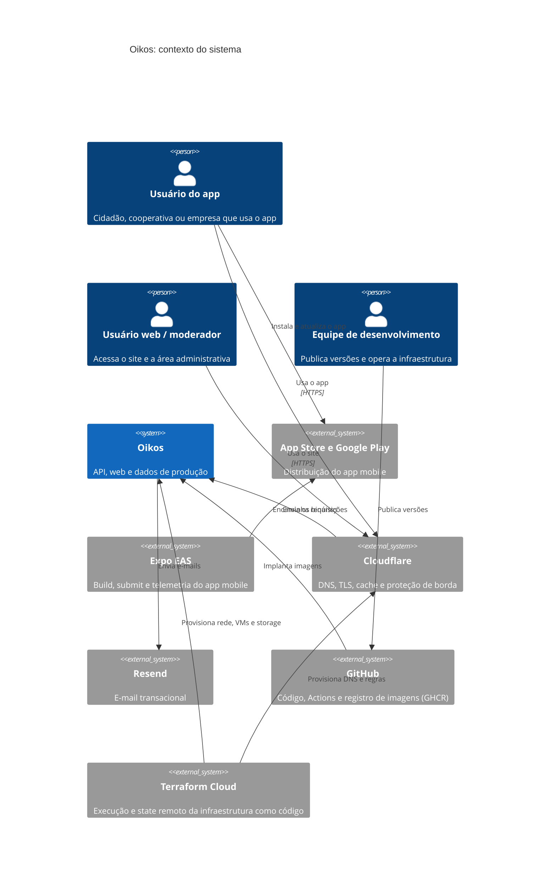
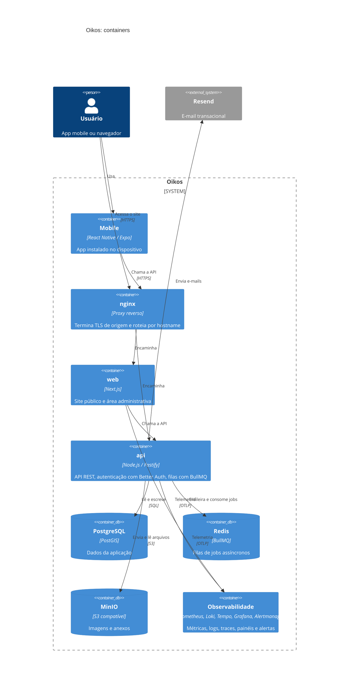
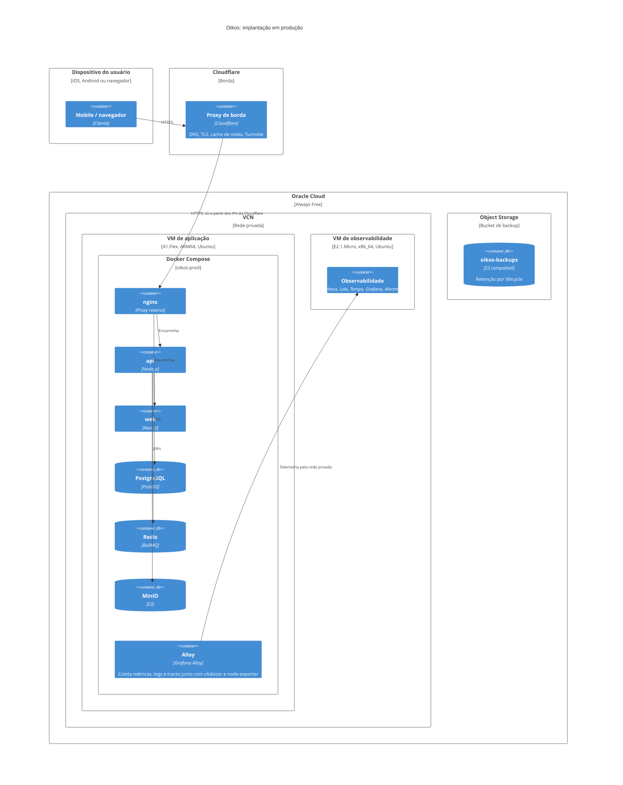
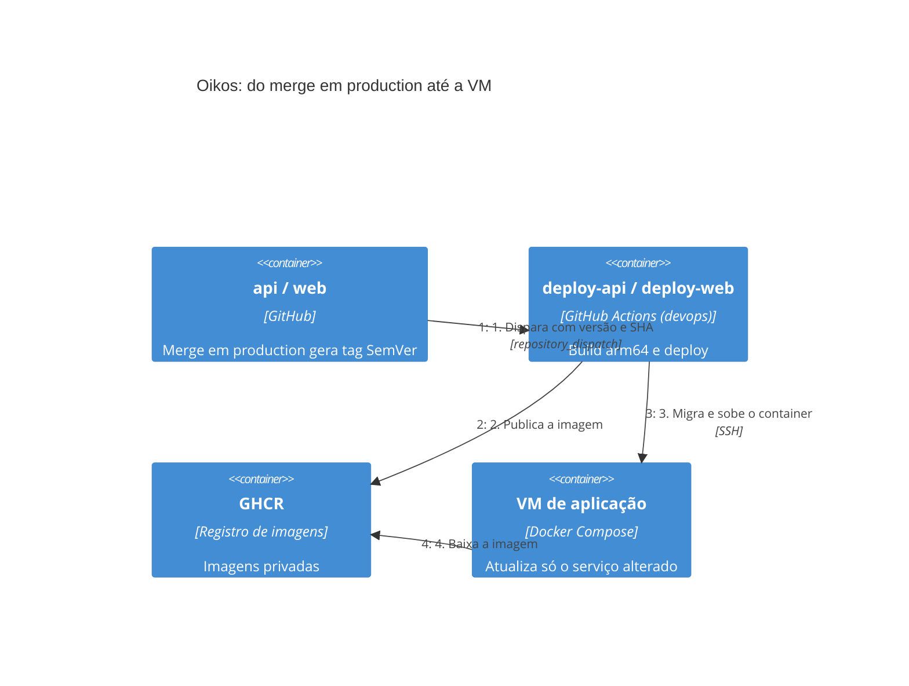

# Oikos · devops

Infraestrutura, deploy e observabilidade da plataforma Oikos. Este repositório não tem código de produto. Ele define onde a `api` e o `web` rodam, como chegam lá e como são monitorados. O app `mobile` é distribuído pelas lojas via Expo e só consome a API.

Os diagramas abaixo seguem o modelo C4. A fonte deles é o workspace do Structurizr em [`docker/structurizr/data/workspace.dsl`](docker/structurizr/data/workspace.dsl). Aqui eles aparecem em Mermaid para ler direto no GitHub. Segredos, endereços IP e portas ficam de fora de propósito.

## Contexto

Quem usa o Oikos e com quais serviços externos ele conversa.



## Containers

O que roda dentro do Oikos e como as partes se falam.



A `api` é organizada em módulos: `auth` (Better Auth), `accounts`, `profiles`, `companies`, `wastes`, `market`, `complaints` (denúncia cidadã com geolocalização), `moderation` (denúncias internas e suporte) e `storage` (proxy do MinIO).

## Implantação em produção

Tudo roda no plano Always Free da Oracle Cloud, em duas VMs dentro da mesma rede privada (VCN).



Pontos que valem saber:

- A VM de aplicação só aceita HTTPS vindo dos blocos de IP da Cloudflare. Ninguém fala direto com a origem pelo site.
- A VM de observabilidade não tem IP público. Ela só recebe tráfego da VM de aplicação, pela rede privada.
- Banco, Redis e a API S3 do MinIO não são expostos para fora do Docker. O Grafana e o console do MinIO passam pelo nginx e exigem login próprio.
- O acesso administrativo às VMs é só por SSH com chave. Senha e login de root ficam desativados pelo cloud-init.
- O bucket de backup existe, mas hoje não há rotina de backup rodando. O redesenho está na [devops#90](https://github.com/oikos-circular-environment/devops/issues/90).

## Entrega contínua

Cada repositório de produto gera a própria versão. Este repositório só implanta.



| Workflow | Quando roda | O que faz |
|---|---|---|
| `deploy-api.yml` | Release da `api` ou execução manual | Build da imagem, migrations e deploy do container da API |
| `deploy-web.yml` | Release do `web` ou execução manual | Build da imagem e deploy do container do site |
| `deploy-infra.yml` | Push em `production` que mexe em `docker/` ou `nginx/` | Sincroniza arquivos e reconcilia a stack da VM de aplicação |
| `deploy-observability.yml` | Push em `production` que mexe em `observability/` | Reconcilia a stack da VM de observabilidade |

O app mobile segue outro caminho: o push na branch `production` do repositório `mobile` dispara o workflow do Expo EAS, que roda as checagens, compila e envia para App Store Connect e Google Play.

## Infraestrutura como código

O Terraform fica em [`infra/terraform`](infra/terraform) e roda no Terraform Cloud, que guarda o state remoto.

| Módulo | Recursos |
|---|---|
| `network` | VCN, sub-redes pública e privada, gateways e regras de firewall |
| `compute` | As duas VMs, com provisionamento por cloud-init |
| `storage` | Bucket de backup, lifecycle e permissão restrita à VM de aplicação |
| `dns` | Registros DNS, certificado de origem, cache de mídia e Turnstile na Cloudflare |

## Estrutura do repositório

| Pasta | Conteúdo |
|---|---|
| `docker/` | Compose e Dockerfiles de produção, e o workspace do Structurizr |
| `nginx/` | Configuração do proxy reverso |
| `observability/` | Stack de observabilidade, dashboards e alertas |
| `infra/terraform/` | Infraestrutura como código |
| `.github/` | Workflows de deploy e actions compartilhadas |
| `load-tests/` | Testes de carga com k6 |
| `docs/` | Decisões, runbooks e estimativa de custo |
| `plans/` | Planos e tickets em andamento |

## Documentação

- [Infraestrutura Oracle Cloud](docs/infrastructure.md): recursos, custos e decisões
- [Docker e deploy](docs/docker-infra.md): pipeline, segredos, capacidade e problemas conhecidos
- [Diagramas de arquitetura](docs/architecture-diagrams.md): como editar e exportar os diagramas C4
- [Runbook de restore](docs/backup-restore-runbook.md)
- [Credenciais do Terraform Cloud](docs/terraform-cloud-credentials-setup.md)
- [Estimativa de custo mensal](docs/estimativa-custo-mensal.md)

## Editando os diagramas

O workspace do Structurizr roda localmente:

```bash
docker compose -f docker/docker-compose.structurizr.yml up -d
```

Depois de alterar o `workspace.dsl`, atualize os diagramas Mermaid deste README para continuarem iguais ao modelo.
