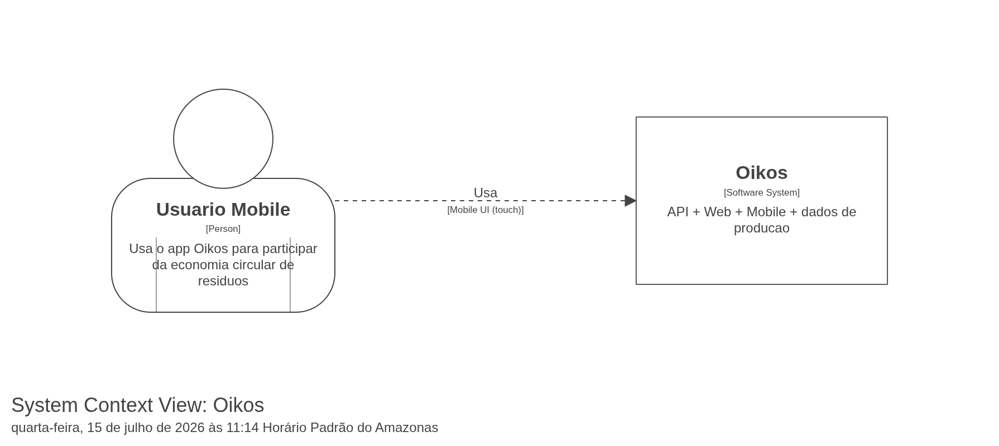
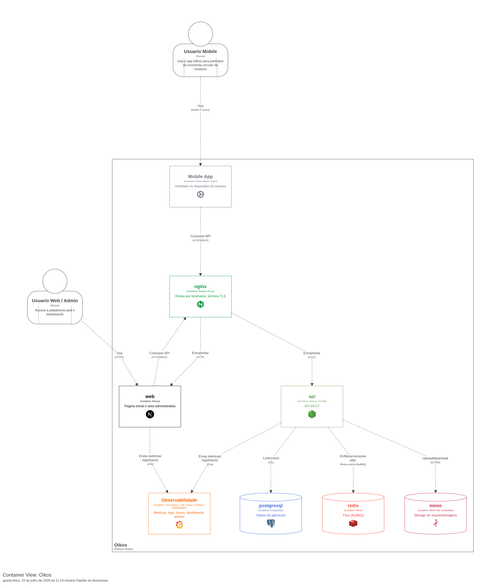
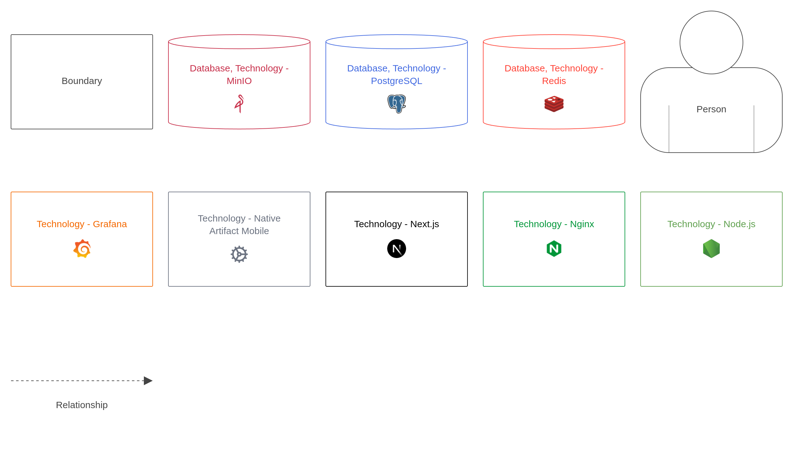
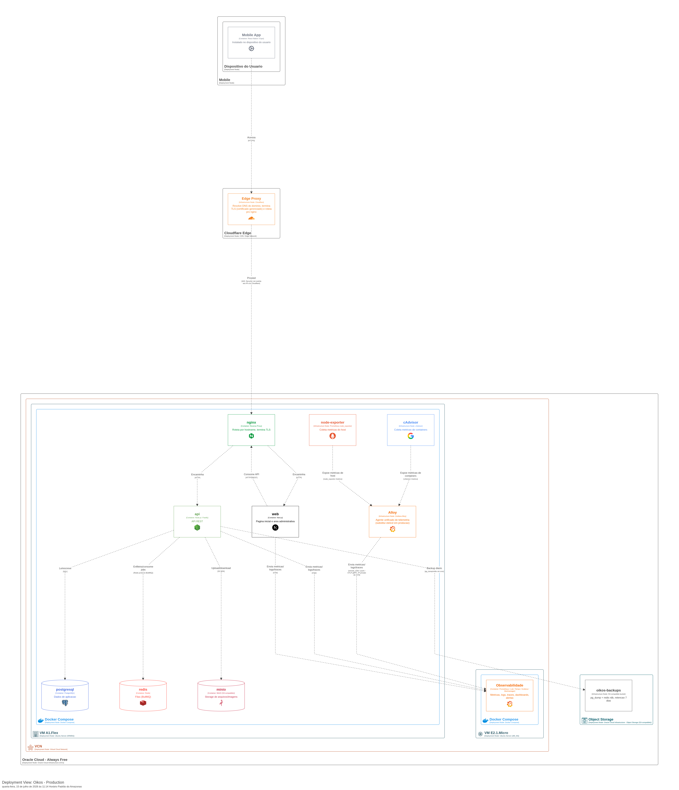
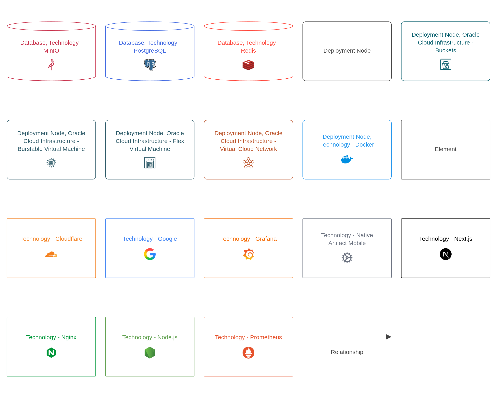
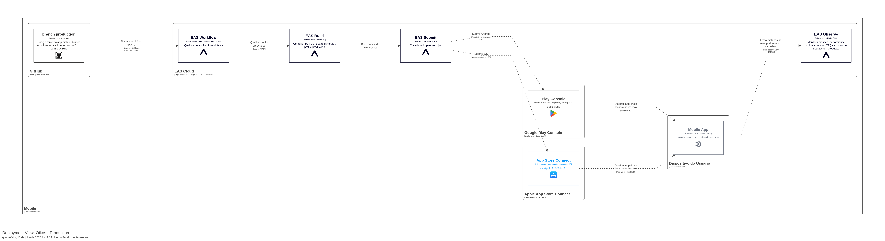
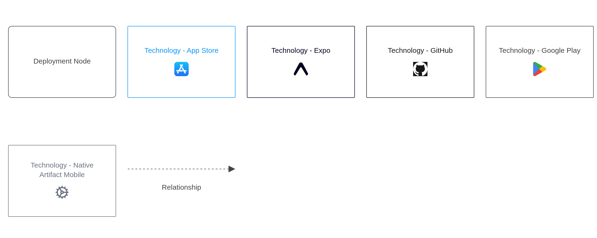

# Oikos · devops

Infraestrutura, deploy e observabilidade da plataforma Oikos. Este repositório não tem código de produto. Ele define onde a `api` e o `web` rodam, como chegam lá e como são monitorados. O app `mobile` é distribuído pelas lojas via Expo e só consome a API.

Os diagramas abaixo seguem o modelo C4 e foram gerados no Structurizr a partir de [`docker/structurizr/data/workspace.dsl`](docker/structurizr/data/workspace.dsl). As imagens exportadas ficam em [`docs/diagrams`](docs/diagrams).

## Notas do autor

O repositório está público apenas para fins de compreensão. As decições de infraestrutura e deploy em maior parte foram feitas visando baixo custo ou zero custo, e não necessariamente alta disponibilidade ou escalabilidade. Certamente há soluções e metodos melhores de subir toda a plataforma, mas o objetivo aqui é apenas documentar como o Oikos roda hoje.

Quem estiver interessado em subir e testar o projeto em sua própria infraestrutura, recomendo não usar este repositório.

Mas para quem quiser replicar:
- Oracle Cloud, o uso dela hoje é gratuito, leia [Recursos Always Free](https://docs.oracle.com/pt-br/iaas/Content/FreeTier/freetier_topic-Always_Free_Resources.htm) para entender os limites do plano Always Free. Para que você ative a conta e utilize os recursos, é necessário um cartão de crédito válido. Porém eles descontam R$ 500,00 de crédito, oque dá um baita susto, mas depois eles devolvem o valor.

- Cloudflare, estou usando todos os serviços gratuitos, incluindo o Turnstile, que é uma alternativa ao reCAPTCHA. E é bem generoso todos os recursos que eles oferecem.

- Terraform Cloud, o uso gratuito para uso pessoal é bem generoso também, vale a pena testar os recursos.

- Observabilidade, Grafana auto hospedada, dentro de uma máquina ARM na Oracle Cloud, com Prometheus, Loki e Tempo. A quantidade de recursos é limitada então cuidado, se você exceder os limites do plano Always Free, a Oracle Cloud irá cobrar o valor excedente, então é bom ficar de olho no uso de CPU, memória e disco. Mas caso você não queira lidar com isso, sugiro usar o Grafana Cloud, que é gratuito para uso pessoal e tem recursos bem generosos. Sentry também é gratuito, tem uma retenção de 14 dias apenas, mas é suficiente para a maioria dos casos.

- MinIO, é um serviço de armazenamento de objetos compatível com S3, que roda dentro da VM de aplicação. Ele é gratuito e open source, mas não é recomendado para produção, pois não tem suporte oficial. Mas para fins de teste e desenvolvimento, ele é uma ótima opção. O AWS S3 seria melhor para produção, valor de custo é baixo.

De resto, a infraestrutura ela pode ser subido em qualquer provedor de nuvem que você desejar, recomendo ver sobre o AWS LightSail, que é bem barato e tem um bom desempenho também. Mas para fins de teste, a Oracle Cloud é uma ótima opção, pois é gratuita e tem recursos bem generosos.

Olhando  hoje eu faria diferente, e subiria a infraestrutura na AWS LightSail e não rodaria dentro de Terraform Cloud e nem Grafana auto hospedada, mas sim no Grafana Cloud, que é gratuito e não tem toda a complexidade de construir e manter a infraestrutura de observabilidade. Mas como eu não sabia antes como funcionava Oracle, Grafana e Terraform, acabei optando para aprender e testar tudo isso.


## Contexto

Quem usa o Oikos.



## Containers

O que roda dentro do Oikos e como as partes se falam.



<details><summary>Legenda</summary>



</details>

A `api` é organizada em módulos: `auth` (Better Auth), `accounts`, `profiles`, `companies`, `wastes`, `market`, `complaints` (denúncia cidadã com geolocalização), `moderation` (denúncias internas e suporte) e `storage` (proxy do MinIO).

## Implantação em produção

Tudo roda no plano Always Free da Oracle Cloud, em duas VMs dentro da mesma rede privada (VCN).



<details><summary>Legenda</summary>



</details>

Pontos que valem saber:

- A VM de aplicação só aceita HTTPS vindo dos blocos de IP da Cloudflare. Ninguém fala direto com a origem pelo site.
- A VM de observabilidade não tem IP público. Ela só recebe tráfego da VM de aplicação, pela rede privada.
- Banco, Redis e a API S3 do MinIO não são expostos para fora do Docker. O Grafana e o console do MinIO passam pelo nginx e exigem login próprio.
- O acesso administrativo às VMs é só por SSH com chave. Senha e login de root ficam desativados pelo cloud-init.
- O bucket de backup existe, mas hoje não há rotina de backup rodando, apesar de o diagrama ainda mostrar o backup diário. O redesenho está na [devops#90](https://github.com/oikos-circular-environment/devops/issues/90).

## Entrega contínua

Cada repositório de produto gera a própria versão. Este repositório só implanta.

| Workflow | Quando roda | O que faz |
|---|---|---|
| `deploy-api.yml` | Release da `api` ou execução manual | Build da imagem, migrations e deploy do container da API |
| `deploy-web.yml` | Release do `web` ou execução manual | Build da imagem e deploy do container do site |
| `deploy-infra.yml` | Push em `production` que mexe em `docker/` ou `nginx/` | Sincroniza arquivos e reconcilia a stack da VM de aplicação |
| `deploy-observability.yml` | Push em `production` que mexe em `observability/` | Reconcilia a stack da VM de observabilidade |

O app mobile segue outro caminho: o push na branch `production` do repositório `mobile` dispara o workflow do Expo EAS, que roda as checagens, compila e envia para App Store Connect e Google Play.



<details><summary>Legenda</summary>



</details>

## Infraestrutura como código

O Terraform fica em [`infra/terraform`](infra/terraform) e roda no Terraform Cloud, que guarda o state remoto.

| Módulo | Recursos |
|---|---|
| `network` | VCN, sub-redes pública e privada, gateways e regras de firewall |
| `compute` | As duas VMs, com provisionamento por cloud-init |
| `storage` | Bucket de backup, lifecycle e permissão restrita à VM de aplicação |
| `dns` | Registros DNS, certificado de origem, cache de mídia e Turnstile na Cloudflare |

## Estrutura do repositório

| Pasta | Conteúdo |
|---|---|
| `docker/` | Compose e Dockerfiles de produção, e o workspace do Structurizr |
| `nginx/` | Configuração do proxy reverso |
| `observability/` | Stack de observabilidade, dashboards e alertas |
| `infra/terraform/` | Infraestrutura como código |
| `.github/` | Workflows de deploy e actions compartilhadas |
| `load-tests/` | Testes de carga com k6 |
| `docs/` | Decisões, runbooks e estimativa de custo |
| `plans/` | Planos e tickets em andamento |

## Documentação

- [Infraestrutura Oracle Cloud](docs/infrastructure.md): recursos, custos e decisões
- [Docker e deploy](docs/docker-infra.md): pipeline, segredos, capacidade e problemas conhecidos
- [Diagramas de arquitetura](docs/architecture-diagrams.md): como editar e exportar os diagramas C4
- [Runbook de restore](docs/backup-restore-runbook.md)
- [Credenciais do Terraform Cloud](docs/terraform-cloud-credentials-setup.md)
- [Estimativa de custo mensal](docs/estimativa-custo-mensal.md)

## Editando os diagramas

O workspace do Structurizr roda localmente:

```bash
docker compose -f docker/docker-compose.structurizr.yml up -d
```

Depois de alterar o `workspace.dsl`, exporte as views em PNG pela interface do Structurizr e substitua os arquivos em `docs/diagrams/`.
