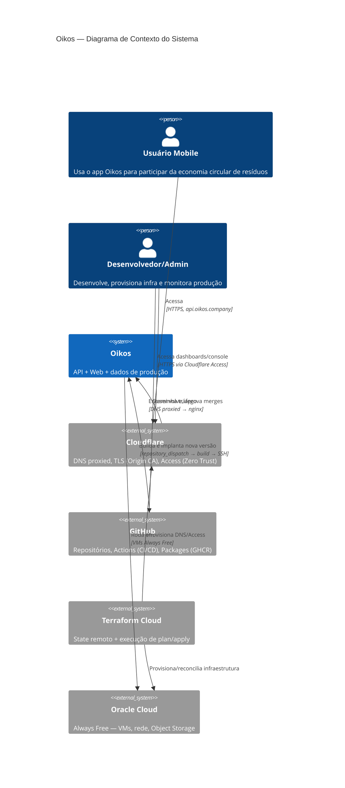
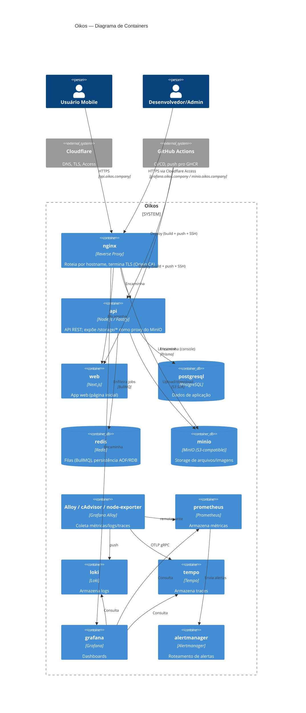
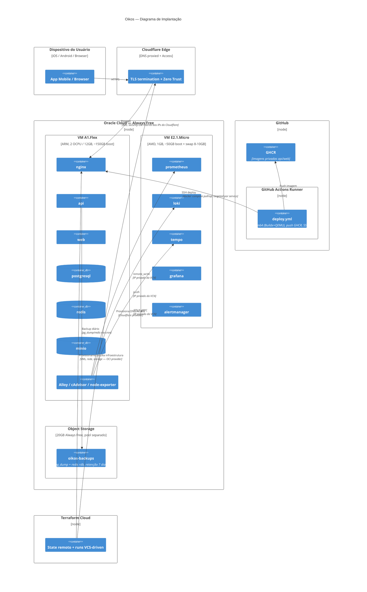

# Oikos — Diagramas C4 (Infraestrutura de Produção)

Diagramas em Mermaid, notação C4 (System Context, Container, Deployment). Referem-se ao desenho descrito em [`plans/oracle-cloud-migration/04-tech-plan.md`](../plans/oracle-cloud-migration/04-tech-plan.md) e aos valores em [`infrastructure.md`](./infrastructure.md). Atualizar junto com qualquer mudança na Abordagem Arquitetural do tech-plan.

## System Context

Visão de mais alto nível: quem usa o Oikos e com quais sistemas externos ele se relaciona.

## Container

Zoom nos containers que compõem o Oikos — inclui a divisão lógica entre a stack de aplicação e a stack de observabilidade (a separação física por VM fica no diagrama de Deployment).

## Deployment

Onde cada container roda de fato — as duas VMs Oracle Always Free, o bucket de backup, e os sistemas externos (GitHub, Terraform Cloud, Cloudflare) que operam a infraestrutura.

