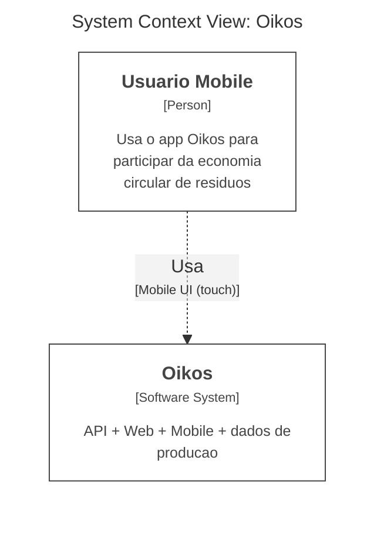
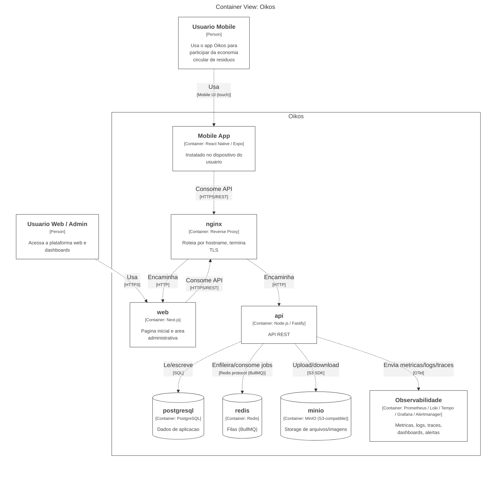
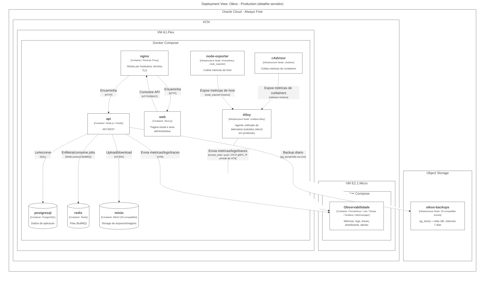

# Oikos — Diagramas C4 (Infraestrutura de Produção)

Diagramas em Mermaid, notação C4 (System Context, Container, Deployment). As três views são geradas e validadas a partir da DSL do Structurizr (`devops/docker/structurizr/data/workspace.dsl`) via o MCP self-hospedado (`structurizr/mcp`, ver `docker-compose.structurizr.yml`). Referem-se ao desenho descrito em [`plans/oracle-cloud-migration/04-tech-plan.md`](../plans/oracle-cloud-migration/04-tech-plan.md) e aos valores em [`infrastructure.md`](./infrastructure.md). Atualizar junto com qualquer mudança na Abordagem Arquitetural do tech-plan.

Para regenerar após mudar a DSL: rode as tools `validate` e `export-mermaid` do MCP (`http://127.0.0.1:3210/mcp`, viewKeys `OikosContext`, `OikosContainer`, `OikosDeploy`, `OikosServerDeploy`). **A linha `theme oikos-oci` no fim do bloco `views` quebra o `structurizr-mcp`** (ele recusa `theme` baseado em arquivo local mesmo com `STRUCTURIZR_FEATURE_DSL_FILESYSTEM=true` — testado, é uma trava fixa dessa ferramenta) — remova essa linha temporariamente do texto que for passar pro `validate`/`export-mermaid`, valide, e não esqueça de restaurá-la no arquivo real.

> Os elementos taggeados com Oracle Cloud Infrastructure (`Oracle Cloud Infrastructure - Flex Virtual Machine`, `- Burstable Virtual Machine`, `- Buckets`, `- Virtual Cloud Network`) usam um tema **local**, `docker/structurizr/data/themes/oikos-oci/`, com 4 ícones baixados de `static.structurizr.com/themes/oracle-cloud-infrastructure-2023.04.01/` (mesmo pack "Graphics for Topologies and Diagrams" da Oracle, mas já recortado em PNGs individuais). Isso evita depender do tema remoto oficial, que este `structurizr/mcp` não resolve (loga aviso de EOL do serviço em 30/09/2026) e que vai sumir de vez depois disso. O tema local só é aplicado pelo serviço `structurizr` (UI em `127.0.0.1:8080`) — os diagramas Mermaid deste arquivo **não** mostram ícone (exportador Mermaid do MCP não embute imagem; testado, só `export-plantuml` embute via ``, e não usamos PlantUML aqui).

> Para levantar o `structurizr` local (UI em `127.0.0.1:8080`), suba manualmente com `docker compose -f docker-compose.structurizr.yml up -d` depois que o disco onde este repo vive estiver montado. Os dois serviços (`structurizr`, `structurizr-mcp`) têm `restart: "no"` de propósito — não sobem sozinhos no boot, porque se o disco de desenvolvimento ainda não estiver montado quando o Docker inicia, o bind mount `./structurizr/data` é recriado vazio no disco raiz.

## System Context

Visão de mais alto nível: quem usa o Oikos.

## Container

Zoom nos containers que compõem o Oikos, incluindo o app mobile e a stack de observabilidade agrupada.

## Deployment

Onde cada container roda de fato — as duas VMs Oracle Always Free (dentro da mesma VCN), o bucket de backup, e os sistemas externos (GitHub, Terraform Cloud, Cloudflare) que operam a infraestrutura.

```mermaid
graph LR
  linkStyle default fill:#ffffff

  subgraph diagram ["Deployment View: Oikos - Production"]
    style diagram fill:#ffffff,stroke:#ffffff

    subgraph 46 ["GitHub"]
      style 46 fill:#ffffff,stroke:#444444,color:#444444

      48["<div style='font-weight: bold'>deploy.yml</div><div style='font-size: 70%; margin-top: 0px'>[Infrastructure Node: GitHub Actions Workflow]</div><div style='font-size: 80%; margin-top:10px'>Build arm64 (Buildx+QEMU),<br />push GHCR, SSH deploy</div>"]
      style 48 fill:#ffffff,stroke:#444444,color:#444444
      49["<div style='font-weight: bold'>GHCR</div><div style='font-size: 70%; margin-top: 0px'>[Infrastructure Node: GitHub Container Registry]</div><div style='font-size: 80%; margin-top:10px'>Imagens privadas api/web</div>"]
      style 49 fill:#ffffff,stroke:#444444,color:#444444
    end

    subgraph 58 ["Dispositivo do Usuario"]
      style 58 fill:#ffffff,stroke:#444444,color:#444444

      59["<div style='font-weight: bold'>Mobile App</div><div style='font-size: 70%; margin-top: 0px'>[Container: React Native / Expo]</div><div style='font-size: 80%; margin-top:10px'>Instalado no dispositivo do<br />usuario</div>"]
      style 59 fill:#ffffff,stroke:#444444,color:#444444
    end

    subgraph 60 ["Cloudflare Edge"]
      style 60 fill:#ffffff,stroke:#444444,color:#444444

      61["<div style='font-weight: bold'>TLS termination</div><div style='font-size: 70%; margin-top: 0px'>[Infrastructure Node: Cloudflare]</div><div style='font-size: 80%; margin-top:10px'>Termina TLS e roteia pro<br />nginx</div>"]
      style 61 fill:#ffffff,stroke:#444444,color:#444444
    end

    subgraph 62 ["Terraform Cloud"]
      style 62 fill:#ffffff,stroke:#444444,color:#444444

      63["<div style='font-weight: bold'>State remoto</div><div style='font-size: 70%; margin-top: 0px'>[Infrastructure Node: Terraform Cloud]</div><div style='font-size: 80%; margin-top:10px'>Runs VCS-driven, aplica<br />mudancas de IaC</div>"]
      style 63 fill:#ffffff,stroke:#444444,color:#444444
    end

    subgraph 64 ["Oracle Cloud - Always Free"]
      style 64 fill:#ffffff,stroke:#444444,color:#444444

      subgraph 65 ["VCN"]
        style 65 fill:#ffffff,stroke:#444444,color:#444444

        subgraph 66 ["VM A1.Flex"]
          style 66 fill:#ffffff,stroke:#444444,color:#444444

          subgraph 67 ["Docker Compose"]
            style 67 fill:#ffffff,stroke:#444444,color:#444444

            68["<div style='font-weight: bold'>nginx</div><div style='font-size: 70%; margin-top: 0px'>[Container: Reverse Proxy]</div><div style='font-size: 80%; margin-top:10px'>Roteia por hostname, termina<br />TLS</div>"]
            style 68 fill:#ffffff,stroke:#444444,color:#444444
            70["<div style='font-weight: bold'>api</div><div style='font-size: 70%; margin-top: 0px'>[Container: Node.js / Fastify]</div><div style='font-size: 80%; margin-top:10px'>API REST</div>"]
            style 70 fill:#ffffff,stroke:#444444,color:#444444
            72["<div style='font-weight: bold'>web</div><div style='font-size: 70%; margin-top: 0px'>[Container: Next.js]</div><div style='font-size: 80%; margin-top:10px'>Pagina inicial e area<br />administrativa</div>"]
            style 72 fill:#ffffff,stroke:#444444,color:#444444
            75[("<div style='font-weight: bold'>postgresql</div><div style='font-size: 70%; margin-top: 0px'>[Container: PostgreSQL]</div><div style='font-size: 80%; margin-top:10px'>Dados de aplicacao</div>")]
            style 75 fill:#ffffff,stroke:#444444,color:#444444
            77[("<div style='font-weight: bold'>redis</div><div style='font-size: 70%; margin-top: 0px'>[Container: Redis]</div><div style='font-size: 80%; margin-top:10px'>Filas (BullMQ)</div>")]
            style 77 fill:#ffffff,stroke:#444444,color:#444444
            79[("<div style='font-weight: bold'>minio</div><div style='font-size: 70%; margin-top: 0px'>[Container: MinIO (S3-compatible)]</div><div style='font-size: 80%; margin-top:10px'>Storage de arquivos/imagens</div>")]
            style 79 fill:#ffffff,stroke:#444444,color:#444444
            81["<div style='font-weight: bold'>cAdvisor</div><div style='font-size: 70%; margin-top: 0px'>[Infrastructure Node: cAdvisor]</div><div style='font-size: 80%; margin-top:10px'>Coleta metricas de containers</div>"]
            style 81 fill:#ffffff,stroke:#444444,color:#444444
            82["<div style='font-weight: bold'>node-exporter</div><div style='font-size: 70%; margin-top: 0px'>[Infrastructure Node: Prometheus node_exporter]</div><div style='font-size: 80%; margin-top:10px'>Coleta metricas do host</div>"]
            style 82 fill:#ffffff,stroke:#444444,color:#444444
            83["<div style='font-weight: bold'>Alloy</div><div style='font-size: 70%; margin-top: 0px'>[Infrastructure Node: Grafana Alloy]</div><div style='font-size: 80%; margin-top:10px'>Agente unificado de<br />telemetria (substitui otelcol<br />em producao)</div>"]
            style 83 fill:#ffffff,stroke:#444444,color:#444444
          end

        end

        subgraph 84 ["VM E2.1.Micro"]
          style 84 fill:#ffffff,stroke:#444444,color:#444444

          subgraph 85 ["Docker Compose"]
            style 85 fill:#ffffff,stroke:#444444,color:#444444

            86["<div style='font-weight: bold'>Observabilidade</div><div style='font-size: 70%; margin-top: 0px'>[Container: Prometheus / Loki / Tempo / Grafana / Alertmanager]</div><div style='font-size: 80%; margin-top:10px'>Metricas, logs, traces,<br />dashboards, alertas</div>"]
            style 86 fill:#ffffff,stroke:#444444,color:#444444
          end

        end

      end

      subgraph 88 ["Object Storage"]
        style 88 fill:#ffffff,stroke:#444444,color:#444444

        89["<div style='font-weight: bold'>oikos-backups</div><div style='font-size: 70%; margin-top: 0px'>[Infrastructure Node: S3-compatible bucket]</div><div style='font-size: 80%; margin-top:10px'>pg_dump + redis rdb, retencao<br />7 dias</div>"]
        style 89 fill:#ffffff,stroke:#444444,color:#444444
      end

    end

    83-. "<div>Envia metricas/logs/traces</div><div style='font-size: 70%'>[remote_write / push / OTLP gRPC, IP privado da VCN]</div>" .->86
    48-. "<div>Push imagem</div><div style='font-size: 70%'>[Docker push (OCI Registry)]</div>" .->49
    48-. "<div>SSH deploy</div><div style='font-size: 70%'>[docker compose pull/up, targeted por servico]</div>" .->68
    63-. "<div>Provisiona/reconcilia<br />infraestrutura</div><div style='font-size: 70%'>[VMs, rede, storage - OCI provider]</div>" .->68
    63-. "<div>Provisiona DNS</div><div style='font-size: 70%'>[Cloudflare provider]</div>" .->61
    70-. "<div>Backup diario</div><div style='font-size: 70%'>[pg_dump/redis via cron]</div>" .->89
    59-. "<div>Consome API</div><div style='font-size: 70%'>[HTTPS/REST]</div>" .->68
    68-. "<div>Encaminha</div><div style='font-size: 70%'>[HTTP]</div>" .->70
    72-. "<div>Consome API</div><div style='font-size: 70%'>[HTTPS/REST]</div>" .->68
    68-. "<div>Encaminha</div><div style='font-size: 70%'>[HTTP]</div>" .->72
    70-. "<div>Le/escreve</div><div style='font-size: 70%'>[SQL]</div>" .->75
    70-. "<div>Enfileira/consome jobs</div><div style='font-size: 70%'>[Redis protocol (BullMQ)]</div>" .->77
    70-. "<div>Upload/download</div><div style='font-size: 70%'>[S3 SDK]</div>" .->79
    70-. "<div>Envia metricas/logs/traces</div><div style='font-size: 70%'>[OTel]</div>" .->86
    59-. "<div>Acessa</div><div style='font-size: 70%'>[HTTPS]</div>" .->61
    61-. "<div>Proxied</div><div style='font-size: 70%'>[443, Security List restrita aos IPs do Cloudflare]</div>" .->68
    81-. "<div>Expoe metricas de containers</div><div style='font-size: 70%'>[cAdvisor /metrics]</div>" .->83
    82-. "<div>Expoe metricas de host</div><div style='font-size: 70%'>[node_exporter /metrics]</div>" .->83

  end
```

## Deployment — Detalhe de Containers (Servidor)

Zoom só na infraestrutura Oracle Cloud (sem CI/CD, lojas de app ou Cloudflare, já cobertos acima), deixando explícito que `nginx`, `api`, `web`, `postgresql`, `redis`, `minio` e os agentes de observabilidade rodam como containers Docker de fato — `oikos-prod` (`docker/docker-compose.prod.yml`) na VM A1.Flex e `oikos-obs` (`observability/docker-compose.observability.yml` + override de produção) na VM E2.1.Micro. O job `createbuckets` (init do MinIO, não persistente) foi deliberadamente omitido.

