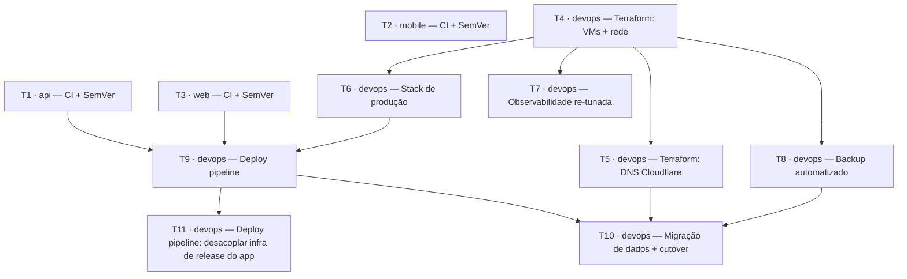

# Migração de Produção para Oracle Cloud — Ticket Breakdown

Baseado em `00-epic-brief.md` e `04-tech-plan.md`. Cada ticket vive em [`tickets/`](./tickets/), com checklist própria de implementação. Ao final de todas, rodar [`tickets/99-review-final.md`](./tickets/99-review-final.md) — checklist de verificação cruzada contra tudo que foi decidido no planejamento.

## Dependências

T2 (mobile) é independente de tudo — pode rodar em paralelo com qualquer outra ticket.

## Tickets

| # | Título | Status | Dependências |
|---|---|---|---|
| [T1](./tickets/01-api-ci-semver.md) | `api` — CI + Versionamento | **Pronta.** Deploy automático validado de ponta a ponta, rodando `v0.0.2` em produção | — |
| [T2](./tickets/02-mobile-ci-semver.md) | `mobile` — CI + Versionamento | Em andamento — `ci.yml` escrito, falta validar rodando | — |
| [T3](./tickets/03-web-ci-semver.md) | `web` — CI + Versionamento | **Pronta.** Deploy automático validado de ponta a ponta, rodando `v0.0.3` em produção | — |
| [T4](./tickets/04-terraform-vms-rede.md) | `devops` — Terraform: VMs + rede | **Pronta.** `apply` rodou, as 2 VMs existem, SSH + Docker confirmados nas duas | — |
| [T5](./tickets/05-terraform-dns-cloudflare.md) | `devops` — Terraform: DNS Cloudflare | **Pronta.** `apply` rodou, DNS + Origin CA aplicados de verdade | T4 |
| [T6](./tickets/06-stack-producao.md) | `devops` — Stack de produção | **Pronta.** Stack completa rodando na `A1.Flex`, validada via internet real (`api`/`web`/`minio` respondendo) | T4 |
| [T7](./tickets/07-observabilidade.md) | `devops` — Observabilidade re-tunada | **Pronta.** Stack rodando na `E2.1.Micro`, dados reais confirmados no Prometheus/Loki/Tempo/Grafana | T4 |
| [T8](./tickets/08-backup-automatizado.md) | `devops` — Backup automatizado | **Pronta.** Backups reais de Postgres e Redis no bucket, timers systemd ativos, restore validado de ponta a ponta | T4 |
| [T9](./tickets/09-deploy-pipeline.md) | `devops` — Deploy pipeline | **Pronta.** `workflow_dispatch` real testado com sucesso de ponta a ponta (build, backup, migration, deploy) | T1, T3, T6, T4 |
| [T10](./tickets/10-migracao-dados-cutover.md) | `devops` — Migração de dados + cutover | Script e checklist de cutover escritos, execução real deferida pra revisão final (ticket 99) | T9, T5, T8 |
| [T11](./tickets/11-deploy-pipeline-infra-only.md) | `devops` — Deploy pipeline: desacoplar infra de release do app | Implementada, aguardando validação real (push em `production` ainda não testado) | T9 |

## Refinamento

Granularidade e agrupamento (por repo/componente) definidos em conjunto com o usuário. Ajustar aqui e nos arquivos individuais se algum ticket precisar ser combinado, dividido ou reordenado.
