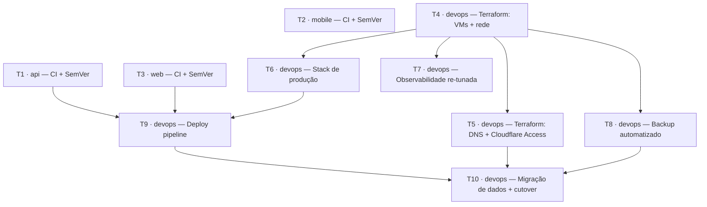

# Migração de Produção para Oracle Cloud — Ticket Breakdown

Baseado em `00-epic-brief.md` e `04-tech-plan.md`. Agrupamento por repositório/componente, pra permitir trabalho isolado onde não há dependência.

## Dependências

T2 (mobile) é independente de tudo — pode rodar em paralelo com qualquer outra ticket.

## T1 — `api`: CI + Versionamento

**Escopo**: `.github/workflows/ci.yml` com format → lint → unit → integration → e2e → (em `production`) tag SemVer automática (PATCH) → `repository_dispatch` (`event_type: api-production`) pro `devops`. Remoção de `docker-compose.prod.yml` e `Dockerfile.prod` do repo. Atualização de `README.md` e `plans/self-hosted-infra/*`. Criação do PAT fine-grained (feito pelo usuário) e do secret no repo `api`.

**Fora de escopo**: qualquer lógica de deploy — isso é 100% do `devops`.

**Referências de spec**: `00-epic-brief.md` §Escopo por Repositório; `04-tech-plan.md` §Arquitetura de Componentes (`oikos/api`).

**Dependências**: nenhuma.

## T2 — `mobile`: CI + Versionamento

**Escopo**: `.github/workflows/ci.yml` com format → lint → test → (em `production`) tag SemVer automática. Sem `repository_dispatch`.

**Fora de escopo**: qualquer integração com `devops` ou lojas (EAS já é gerenciado à parte pelo `mobile`).

**Referências de spec**: `00-epic-brief.md` §Escopo por Repositório.

**Dependências**: nenhuma.

## T3 — `web`: CI + Versionamento

**Escopo**: `.github/workflows/ci.yml` com format → lint → test → (em `production`) tag SemVer automática → `repository_dispatch` (`event_type: web-production`) pro `devops`. `next.config.ts` (`output: "standalone"`) já feito.

**Fora de escopo**: Dockerfile/compose — vivem no `devops`.

**Referências de spec**: `04-tech-plan.md` §Arquitetura de Componentes (`oikos/web`).

**Dependências**: nenhuma.

## T4 — `devops`: Terraform — VMs + Rede

**Escopo**: `infra/terraform/compute/` (VMs `A1.Flex` e `E2.1.Micro`, cloud-init: Docker, usuário `deploy`, swap file na `E2.1.Micro`), `infra/terraform/network/` (VCN, subnet privada, Security Lists), `infra/terraform/backend.tf` (workspace Terraform Cloud). Ponto de partida de tudo — provisiona do zero, sem import.

**Fora de escopo**: DNS/Cloudflare (T5), qualquer container/aplicação rodando nas VMs.

**Referências de spec**: `04-tech-plan.md` §Abordagem Arquitetural, §Arquitetura de Componentes.

**Dependências**: nenhuma.

## T5 — `devops`: Terraform — DNS + Cloudflare Access

**Escopo**: `infra/terraform/dns/` — registros proxied (`api.oikos.company`, `oikos.company`, `grafana.oikos.company`, `minio.oikos.company`), políticas Cloudflare Access (Grafana/MinIO), certificado Origin CA.

**Fora de escopo**: nginx (T6) — aqui só a parte Cloudflare/DNS.

**Referências de spec**: `04-tech-plan.md` §Abordagem Arquitetural (Exposição pública).

**Dependências**: T4 (precisa do IP público das VMs).

## T6 — `devops`: Stack de Produção

**Escopo**: `docker/Dockerfile.api.prod` (migrado do `api`, `CMD` simplificado — migration sai daqui), `docker/Dockerfile.web.prod` (✅ já feito), `docker/docker-compose.prod.yml` (api, web, postgresql, redis, minio, createbuckets, nginx, Alloy/cAdvisor/node-exporter), `nginx/nginx.conf` (roteamento por hostname + TLS Origin CA).

**Fora de escopo**: pipeline de deploy que usa esses arquivos (T9); observabilidade (T7).

**Referências de spec**: `04-tech-plan.md` §Arquitetura de Componentes (`oikos/devops`).

**Dependências**: T4 (precisa da VM pra testar de verdade, mesmo que os arquivos possam ser escritos em paralelo).

## T7 — `devops`: Observabilidade Re-tunada

**Escopo**: `observability/docker-compose.observability.yml` ajustado pra `E2.1.Micro` (~875MB entre Prometheus/Loki/Tempo/Grafana/Alertmanager), config do Alloy na VM ARM substituindo otelcol.

**Fora de escopo**: dashboards novos (reaproveita os existentes).

**Referências de spec**: `00-epic-brief.md` §Decisão de Arquitetura (Observabilidade); `04-tech-plan.md` §Abordagem Arquitetural.

**Dependências**: T4.

## T8 — `devops`: Backup Automatizado

**Escopo**: `infra/terraform/storage/` (bucket `oikos-backups` + Lifecycle Policy de 7 dias), `scripts/backup-postgres.sh` + `scripts/backup-redis.sh` (cron/systemd timer diário).

**Fora de escopo**: backup do MinIO (fora do MVP, ver epic brief).

**Referências de spec**: `04-tech-plan.md` §Modelo de Dados.

**Dependências**: T4.

## T9 — `devops`: Deploy Pipeline

**Escopo**: `.github/workflows/deploy.yml` — jobs `api-production`/`web-production` (GH Environments homônimos + secrets de nível repo), build arm64 (Buildx+QEMU), push GHCR (privado), SSH deploy: backup de segurança → `docker compose run --rm api prisma migrate deploy` (só `api-production`) → `docker compose pull <serviço> && up -d <serviço>` (targeted). Primeiro deploy via `workflow_dispatch` manual.

**Fora de escopo**: os arquivos de compose em si (T6); provisionamento da VM (T4).

**Referências de spec**: `04-tech-plan.md` §Abordagem Arquitetural (Deploy, Secrets).

**Dependências**: T1, T3 (dispatch precisa existir do lado de origem), T6 (precisa dos compose files), T4 (precisa da VM).

## T10 — `devops`: Migração de Dados + Cutover

**Escopo**: `scripts/migrate-data.sh` (dump/restore Postgres + `mc mirror` MinIO da máquina atual pra VM Oracle), checklist de baixo downtime, corte final do DNS (desativar túnel manual atual).

**Fora de escopo**: backup recorrente (T8) — aqui é só a migração inicial, uso único.

**Referências de spec**: `00-epic-brief.md` §Contexto (Resultado esperado); `04-tech-plan.md`.

**Dependências**: T9 (stack precisa estar rodando de ponta a ponta), T5 (DNS precisa estar pronto pro corte), T8 (backup deve existir antes do cutover, como rede de segurança).
